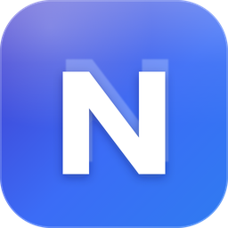
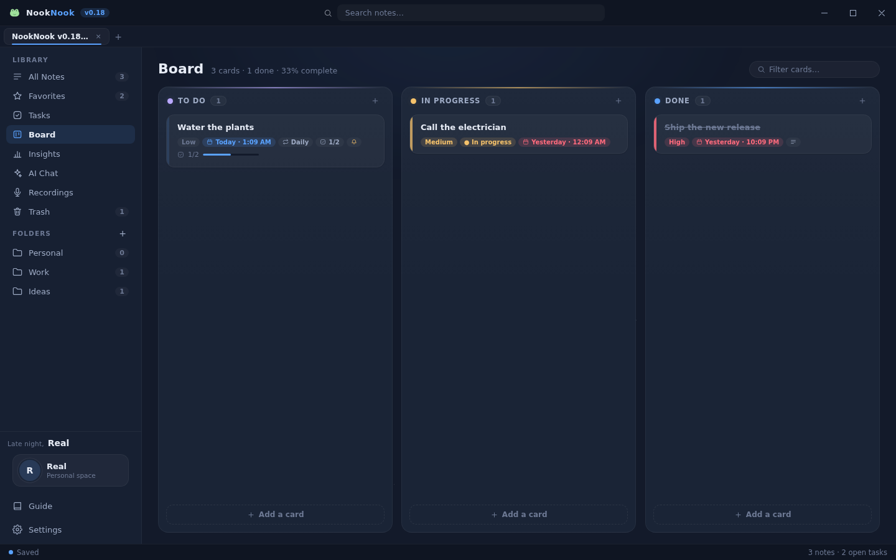
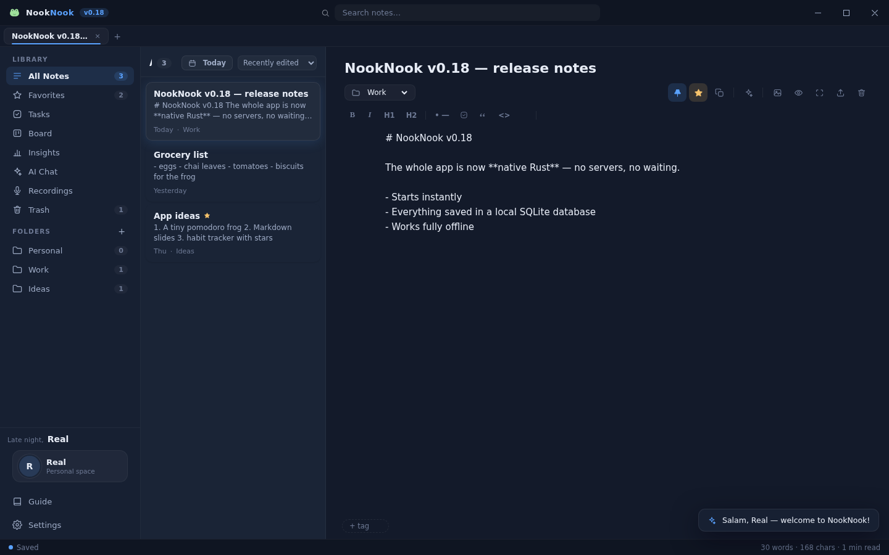
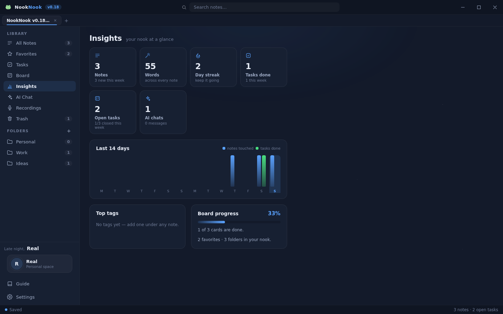
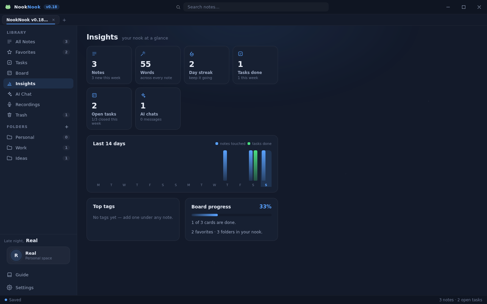

<div align="center">



# NookNook

**Your cozy corner for notes — a 100% offline notes desk for Windows.**

[](https://github.com/MrRealORG/Nook/releases)
[](#)
[](#)
[](LICENSE)
[](https://mrrealorg.github.io/NookNook/)

</div>



NookNook (formerly **Nook**) is a real native desktop app — notes, tasks, a kanban
board, a meeting recorder and AI chat, all living in a local SQLite database on
your own PC. No servers, no accounts, no telemetry, no internet required.
The whole installer is **~2.1 MB**.

## Highlights

| | |
| --- | --- |
| **Rich markdown notes** | Folders, tabs, tags, favorites, find & replace, wiki-links, tables, checklists, live preview, image paste & drop |
| **Tasks that nag politely** | Due dates, priorities, repeat rules, subtasks with progress, real Windows notifications |
| **Kanban board** | Buttery pointer-driven drag & drop, labels, card details, live progress |
| **AI — bring your own key** | OpenRouter, Z.ai (GLM), OpenAI, Groq, Gemini, DeepSeek, Ollama, LM Studio or any OpenAI-compatible endpoint. Keys never leave the PC |
| **Meeting recorder** | One-click .wav recording, fully offline, never freezes the UI |
| **Insights** | Words written, day streaks, tasks done, 14-day activity chart, top tags |
| **24 themes** | Dark & light looks, plus a synthesized sound design and generative lofi that never repeats |
| **Backups & export** | One-click JSON backup & restore, export notes as Markdown or pretty HTML |

## Screenshots

| Editor | AI Chat |
| --- | --- |
|  |  |
| **Insights** | **Board** |
|  |  |

## Install

1. Grab the latest **`NookNook_*_x64-setup.exe`** from
   [Releases](https://github.com/MrRealORG/Nook/releases/latest).
2. Run it — installs per-user, no admin rights needed.
3. Pick your name and theme, start writing.

Your data lives in `%APPDATA%\com.mrreal.nook` — open it from
**Settings → Data → Open folder** anytime. It is yours.

## Build from source

Prerequisites: **Node.js 18+**, **Rust** (stable, with the MSVC toolchain), **npm**.

```bash
git clone https://github.com/MrRealORG/Nook.git
cd Nook
npm install
npm run tauri dev      # run in dev mode
npm run tauri build    # produce installers in src-tauri/target/release/bundle
```

## Tech stack

Tauri 2 (Rust) · vanilla JavaScript + Vite · SQLite (rusqlite) · Web Audio API ·
zero external UI dependencies — the entire interface is hand-built.

## Roadmap

NookNook is in **active daily development — 5 new features & improvements every
day**. Watch the repo to follow along. Recent additions:

- Card detail modal on the board — notes, checklists, priority, due quick-sets, labels
- Command palette (**Ctrl+K**) — actions, navigation, instant theme switching
- Insights view with activity chart, streaks and top tags
- Full rebrand to NookNook with a fresh two-tone identity and a brand-new icon

## License

[MIT](LICENSE) — Copyright (c) 2026 Mr Real. Made cozy for Mr Real.
